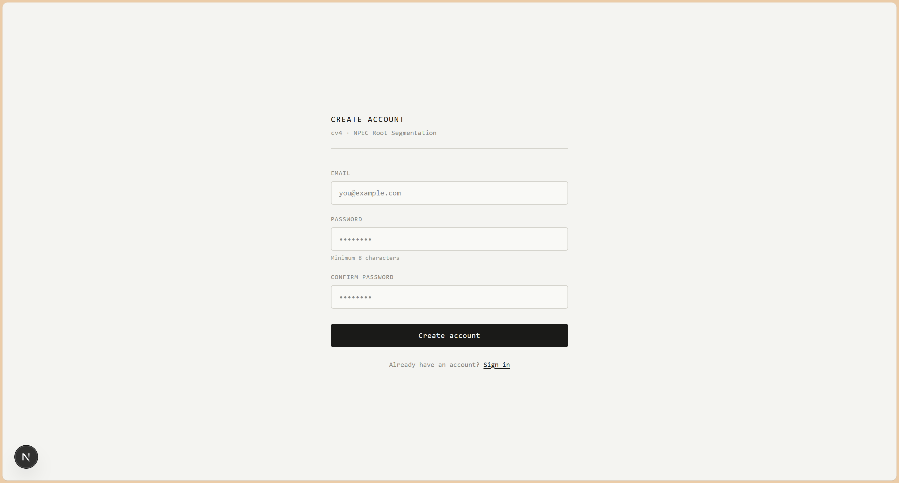
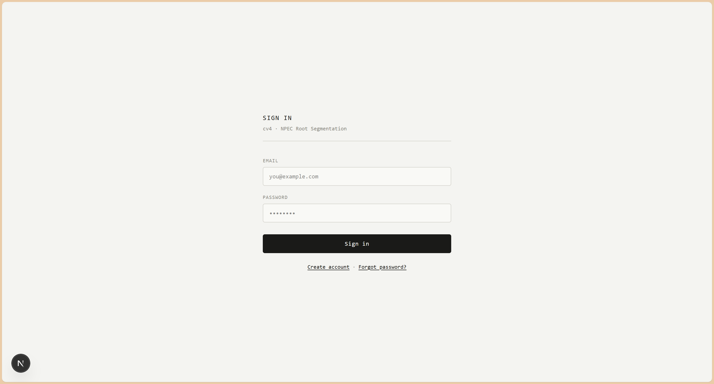
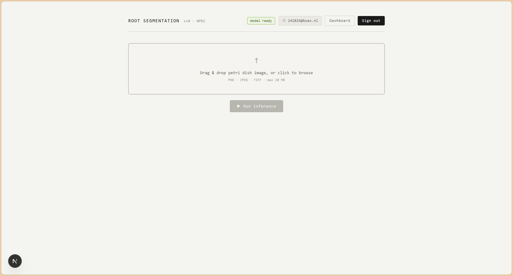
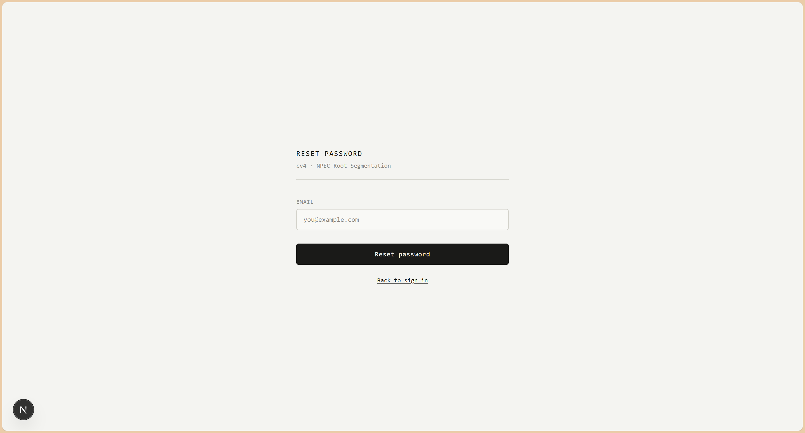
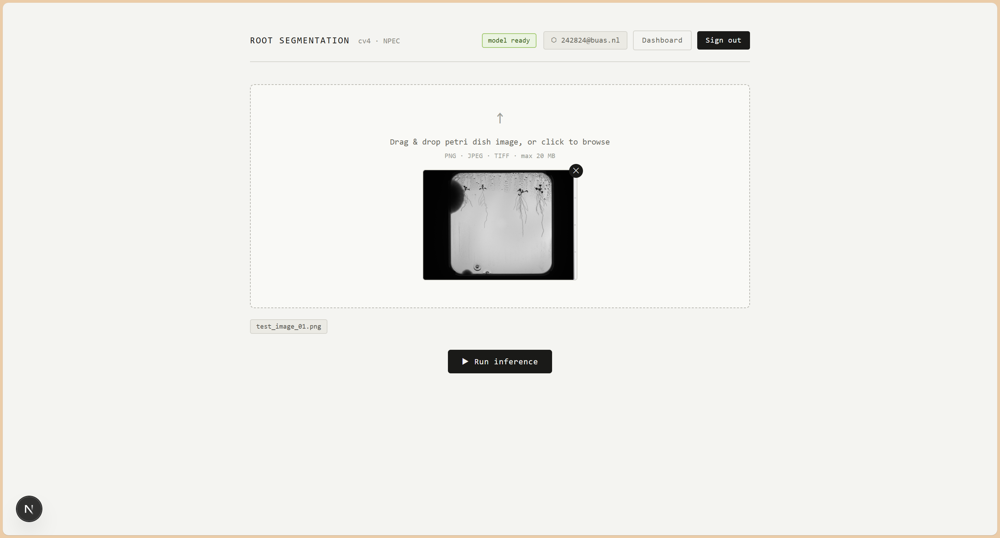
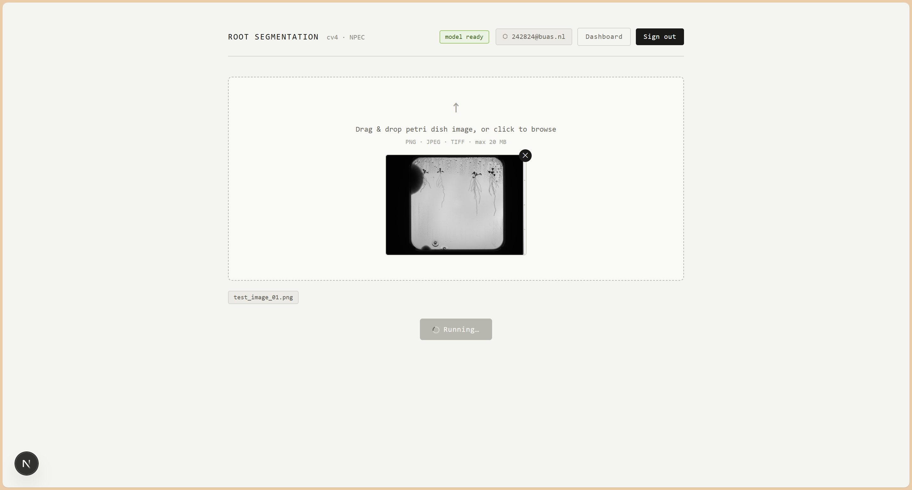
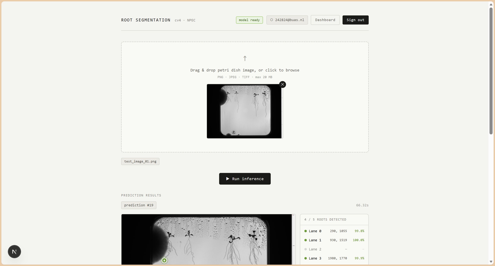
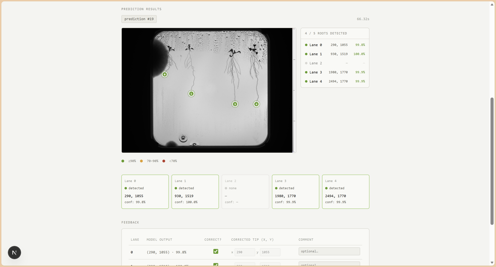
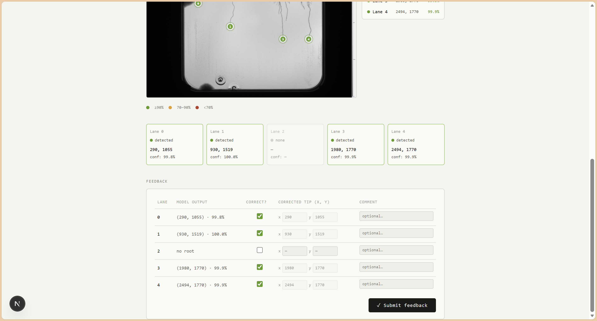
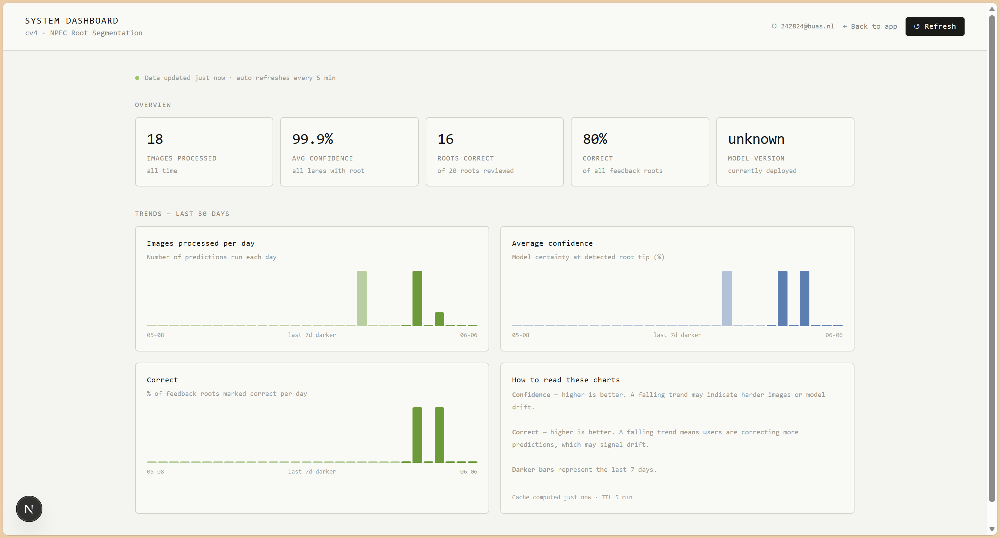

# cv4 Root Segmentation — User Guide

**Tool:** cv4 · NPEC Root Segmentation  
**Audience:** Lab users, non-technical  
**Last updated:** [DATE]  
**Reviewed by:** [REVIEWER NAME]

---

## Table of Contents

1. [What this tool does](#1-what-this-tool-does)
2. [Getting access](#2-getting-access)
3. [Opening the app and signing in](#3-opening-the-app-and-signing-in)
4. [If sign-in fails](#4-if-sign-in-fails)
5. [Uploading an image](#5-uploading-an-image)
6. [Understanding the results](#6-understanding-the-results)
7. [Correcting a prediction](#7-correcting-a-prediction)
8. [Why your feedback matters](#8-why-your-feedback-matters)
9. [The dashboard](#9-the-dashboard)

---

## 1. What this tool does

The Root Segmentation tool analyses photographs of petri dishes containing plant seedlings. It automatically locates the **tip of each root** across the numbered lanes in the dish, and tells you:

- whether a root was found in each lane
- exactly where the root tip is located in the image
- how confident the model is in each detection

Once you have the results, you can flag any mistakes directly in the app. Your corrections feed back into the system to help improve future accuracy.

You do not need any programming knowledge to use the tool. You only need a web browser.

---

## 2. Getting access

You can create your own account, navigate to **https://cv4-frontend.purplefield-a577fae0.westeurope.azurecontainerapps.io//register** and fill in your email address and a password of your choice.
<figure style="text-align:left;">
  
</figure>

---

## 3. Opening the app and signing in

1. Open your web browser and go to **https://cv4-frontend.purplefield-a577fae0.westeurope.azurecontainerapps.io/**.

   > You will be taken to the sign-in page automatically if you are not already logged in.

<figure style="text-align:left;">
   
</figure>

2. Enter the **email address** associated with your account.

3. Enter your **password**.

4. Click **Sign in**.

   If your credentials are correct, you will be taken to the main application page.

<figure style="text-align:left;">
   
</figure>

> **Tip:** Your email address is shown in the top-right corner of the page once you are signed in, so you can always confirm which account you are using.

---

## 4. If sign-in fails

### Wrong email or password

If you see a red error message after clicking **Sign in**, double-check that:

- Your email address is spelled correctly (the system treats upper and lower case the same).
- You do not have caps lock on when typing your password.

### Forgotten password

1. On the sign-in page, click **Forgot password?** below the sign-in button.

<figure style="text-align:left;">
   
   <figcaption>Forgot password page showing the email field and "Reset password" button</figcaption>
</figure>

2. Enter your email address and click **Reset password**.

3. **Currently:** Password reset emails are not yet enabled. After submitting, you will be able to reset your password without needing to confirm by email.

   > **Coming soon:** In a future update, a reset link will be sent directly to your inbox. The link will be valid for 60 minutes.

---

## 5. Uploading an image

### Before you upload

| Requirement | Detail |
|---|---|
| Accepted formats | PNG, JPEG, TIFF |
| Maximum file size | 20 MB |
| Subject | Petri dish photograph with root lanes |

> Images that do not meet these requirements will be rejected with an error message explaining the problem.

### Steps

1. On the main page, you will see the **upload area** — a dashed rectangle with an arrow pointing upward.

<figure style="text-align:left;">
   
</figure>

2. Either:
   - **Drag your image file** from your computer and drop it onto the upload area, or
   - **Click anywhere inside the upload area** to open a file browser, then select your image.

3. A small thumbnail preview of your image will appear inside the upload area, along with the filename shown just below.

<figure style="text-align:left;">
   
</figure>

   > To remove the image and start over, click the small **✕** button in the top-right corner of the thumbnail.

4. Check that the **status indicator** in the top-right of the page reads **model ready** (shown in green). If it reads **offline**, the processing server is temporarily unavailable — wait a moment and refresh the page.

5. Click the **▶ Run inference** button.

<figure style="text-align:left;">
   
   <figcaption>Run inference button in its active (clickable) state</figcaption>
</figure>

6. The button will show a spinning indicator and the text **Running…** while the image is being processed. This usually takes **a few seconds**, but can take up to **3 minutes** for large or complex images. Do not close the browser tab while the analysis is running.

7. Once complete, the results will appear below the upload area.

<figure style="text-align:left;">
   
   <figcaption>Run inference button in its active (clickable) state</figcaption>
</figure>

---

## 6. Understanding the results

### Overview

When the analysis finishes, you will see three things:

- A **prediction number** and **processing time** at the top of the results
- An **annotated image** showing coloured markers at each detected root tip
- A **lane-by-lane summary** table and detail cards

<figure style="text-align:left;">
   
</figure>

---

### The annotated image (overlay)

Your original image is displayed with **coloured circular markers** placed at the tip of each detected root. The colour of each marker tells you how confident the model is:

| Colour | Confidence level | What it means in practice |
|---|---|---|
| 🟢 Green | 90% or above | High confidence — the model is very certain about this detection |
| 🟡 Amber | 70–89% | Moderate confidence — worth a quick visual check |
| 🔴 Red | Below 70% | Low confidence — the model is uncertain; please review carefully |

Hovering your mouse over a marker shows a small tooltip with the lane number, exact position, and confidence score for that root tip.

Markers only appear where a root **was detected**. Lanes with no root detected will not have a marker on the image.

---

### The summary panel

To the right of the image, a small panel lists every lane and shows:

- A coloured dot (using the same green / amber / red scale) indicating confidence
- The lane number
- The position of the detected root tip (see Coordinates below)
- The confidence percentage

Lanes where no root was found are shown in grey and slightly faded.

---

### The lane cards

Below the image, there is a card for each lane. Each card shows:

- **Lane number**
- **Detected / None** — whether a root was found
- **Coordinates** — the pixel position of the root tip (see below)
- **Confidence** — a percentage score

---

### Coordinates (x, y)

The coordinates show **exactly where in the image the root tip was found**, measured in pixels from the top-left corner of the image:

- **x** — how far across (left to right)
- **y** — how far down (top to bottom)

For example, `245, 312` means the tip is 245 pixels from the left edge and 312 pixels from the top of the image.

These numbers are useful if you are exporting results for further analysis. If you are only checking whether roots were detected correctly, you do not need to interpret the numbers yourself — the visual overlay shows you the same information on the image.

---

### Confidence scores — what they mean in practice

The confidence score is the model's own estimate of how certain it is. Think of it like a percentage chance that the detection is correct.

**High confidence (green, ≥90%):** The model found a clearly visible root tip and is very sure of its position. These results rarely need correction.

**Moderate confidence (amber, 70–89%):** The model found a probable root tip but the image may be slightly blurry, the root may be faint, or there may be something interfering with the view. It is worth glancing at the marker position on the image to make sure it looks right.

**Low confidence (red, below 70%):** The model is uncertain. This can happen if the root is very short, the image is out of focus, or the lane contains something unexpected. Please check these detections carefully and use the correction form (see section 7) to flag any errors.

A lane showing **None** with no confidence score means the model did not detect a root in that lane at all. If you can see a root there, mark it as incorrect in the feedback form.

---

### Supported formats and processing time

| Detail | Value |
|---|---|
| Accepted image formats | PNG, JPEG, TIFF |
| Maximum file size | 20 MB |
| Typical processing time | A few seconds |
| Maximum processing time | 3 minutes |

If the request takes longer than 3 minutes, you will see a timeout error. This is rare and usually means the server is under heavy load. Try again after a short wait. If it happens repeatedly, contact **[ADMIN EMAIL]**.

---

## 7. Correcting a prediction

After the results appear, a **Feedback** section is shown below the lane cards. This is where you can tell the system whether each detection is correct or not.

<figure style="text-align:left;">
   
</figure>

### How to use the feedback form

The table has one row per lane. For each lane:

| Column | What to do |
|---|---|
| **Lane** | Lane number — for reference only, no action needed |
| **Model output** | What the model found — shown for reference only |
| **Correct?** | A tick box. It is **ticked by default**, meaning you are confirming the model was right. **Untick it** if the model was wrong |
| **Corrected tip (x, y)** | Only active when a lane is marked incorrect. Enter the true pixel coordinates of the root tip |
| **Comment** | Optional. Add any notes that might help explain the error |

### Step-by-step correction flow

1. Work through each row in the table. If a lane looks correct, leave the **Correct?** box ticked and move on.

2. If a lane is **wrong** — for example, the model placed the marker in the wrong spot, or missed a root entirely — **untick the Correct? box** for that row.

3. The **Corrected tip (x, y)** fields will become active. Enter the pixel coordinates of where the root tip actually is.

4. Optionally, type a short note in the **Comment** field — for example, "root partially obscured" or "no root visible in this lane".

5. Once you have reviewed all lanes, click **✓ Submit feedback**.

### What if a lane has no root but should have one?

If the model says **no root** for a lane but you can see one, untick the **Correct?** box for that lane and enter the coordinates of the root tip you can see. Leave a comment if helpful.

---

## 8. Why your feedback matters

Every correction you submit goes directly into the system's training record. Over time, the accumulated feedback is used to retrain the model and improve its accuracy — especially on the kinds of images your lab produces.

In practical terms:

- **Marking detections as correct** confirms the model is working well for those cases.
- **Correcting wrong detections** gives the model an example it can learn from.
- **Adding comments** helps the team understand patterns (e.g. "blurry images from scanner B tend to confuse the model").

Even a few corrections per session make a meaningful difference over weeks and months. You do not need to correct every image perfectly — just flag what you notice.

---

## 9. The dashboard

The **Dashboard** gives a live summary of how the tool is performing across all users and all images processed so far. It is primarily intended for team leads and administrators, but any logged-in user can view it.

To open the dashboard, click the **Dashboard** button in the top-right corner of the main page.

<figure style="text-align:left;">
   
</figure>

---

### Overview — the KPI cards

At the top of the dashboard you will see five summary figures:

| Card | What it shows |
|---|---|
| **Images processed** | The total number of images analysed by the tool since it was set up |
| **Avg confidence** | The average confidence score across all root detections, expressed as a percentage. Higher is better |
| **Roots correct** | How many individual root detections have been confirmed as correct in the feedback form |
| **Correct %** | The percentage of reviewed root detections that were correct. For example, 94% means the model was right 94 times out of every 100 that users checked |
| **Model version** | The version number of the detection model currently running |

---

### Trend charts — last 30 days

Below the summary cards, three bar charts show how the tool has been performing day by day over the past 30 days. The **darker bars** represent the most recent 7 days; older bars are shown lighter.

Hover over any bar to see the exact value for that date.

| Chart | What it shows | What to look for |
|---|---|---|
| **Images processed per day** | How many images were uploaded and analysed each day | Gives a sense of usage patterns — quiet days vs busy days |
| **Average confidence** | The model's average certainty score each day, as a percentage | A falling trend over time may mean images are becoming harder or the model is becoming less accurate |
| **Correct** | The percentage of reviewed root detections marked as correct each day | A falling trend means users are correcting more results, which may signal a problem with image quality or model accuracy |

---

### Refreshing the dashboard

The dashboard updates automatically every 5 minutes. To force an immediate refresh — for example, after you have submitted a batch of feedback — click the **↺ Refresh** button in the top-right corner.

The small green dot and timestamp at the top of the dashboard body confirm when the data was last updated.
